<p align="center">
  
</p>

<h1 align="center">QuakeLogic HVSR Studio</h1>

<p align="center"><strong>Standalone, offline HVSR analysis for three-component ambient-vibration recordings.</strong><br>
No account. No internet connection. Everything runs on your own computer.</p>

<p align="center">
  <a href="https://github.com/omerozgul11/quakelogic-hvsr-studio/releases/download/latest/QuakeLogic-HVSR-Studio-latest-setup-win-x64.exe"><strong>⬇ Download for Windows (installer)</strong></a> ·
  <a href="https://github.com/omerozgul11/quakelogic-hvsr-studio/releases/download/latest/QuakeLogic-HVSR-Studio-latest-win-x64.zip">portable zip</a> ·
  <a href="https://github.com/omerozgul11/quakelogic-hvsr-studio/releases">all releases</a> ·
  <a href="docs/marketing/quakelogic-hvsr-studio-overview.mp4">watch the 2-minute walkthrough</a>
</p>

---

## What it is

QuakeLogic HVSR Studio is a desktop application for the **horizontal-to-vertical spectral ratio
(HVSR) technique** on ambient-vibration recordings. It takes you from raw three-component data to a
defensible, fully documented result: import and validation, transparent preprocessing, window
selection, the HVSR computation with Konno–Ohmachi smoothing, peak detection with variability
estimates, the SESAME (2004) criteria reported one by one, azimuthal and time-frequency views,
forward modelling against a layered ground model, and a professional PDF report.

It is built for engineers and geophysicists who need results they can explain. Every operation and
parameter is recorded; nothing is interpolated, resampled or rotated silently; dispersion bands are
labelled as what they are; and the software never pretends an H/V amplitude is site amplification
or that an H/V peak fixes a unique velocity profile.

<p align="center">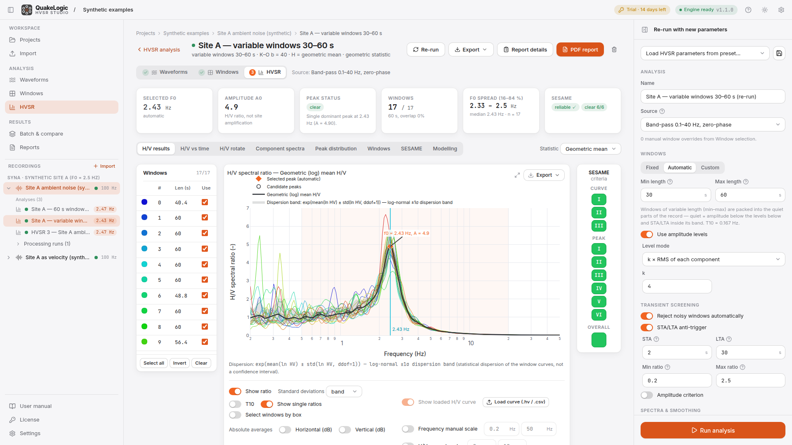</p>

## Highlights

| | |
|---|---|
| **Truly standalone** | One installer, one icon, its own application window. Bundled PHP and Python runtimes, no services to configure, no ports to open, no cloud. Works on a laptop in the field. |
| **Strict, honest import** | TXT/CSV with any delimiter, MiniSEED, SESAME ASCII (SAF), GSE2, SEG-2, SAC. Explicit N/E/Z mapping, timing must be known, and gaps, NaNs, clipping, misalignment and constant channels are flagged, never patched. |
| **Transparent processing** | Mean removal, detrending, polynomial baseline, Butterworth filters (causal or zero-phase) with response plots, notch, taper, crop, anti-aliased resampling, horizontal rotation, instrument-response removal. Every step is recorded with its effective parameters. |
| **Window control** | Fixed, automatic variable-length or custom windows; STA/LTA and amplitude screening; colour-coded windows; a seismogram player to *hear* transients and bookmark them. |
| **A scientific HVSR engine** | Per-window Fourier amplitude spectra, Konno–Ohmachi smoothing on a log axis, geometric-mean / RMS / directional combination, geometric / arithmetic / median statistics with explicit dispersion bands, masked near-zero vertical bins, bootstrap peak intervals with recorded seeds. |
| **SESAME criteria, one by one** | The three reliability and six clarity criteria of the SESAME (2004) guidelines, each with its value, threshold and verdict. |
| **Directional and temporal views** | Azimuth × frequency "rotate" map and H/V-versus-time map for stationarity. |
| **Forward modelling** | Layered Vs/Vp/ρ/Q model → synthetic H/V (Herak 2008 body-wave transfer-function ratio), Vs30 and VsEq, misfit, velocity profile. Clearly labelled as non-unique. |
| **Reports and exports** | CSV, JSON, Geopsy `.hv`, PNG/SVG/PDF figures, window sets, project backups, and a branded PDF report with survey details, photos, quality flags, disclaimer and copyright. |
| **Validated** | 120 engine tests plus an analytic validation suite and a cross-check against hvsrpy with the differences explained (`docs/validation.md`). |

## A tour of the application

### 1. Projects
Everything belongs to a project: stations, recordings, processing runs, analyses, exports and
reports live together in one local folder (SQLite index + files). Back up or share a survey by
copying that folder, or use **Backup** / **Restore** for a single zip.

<p align="center">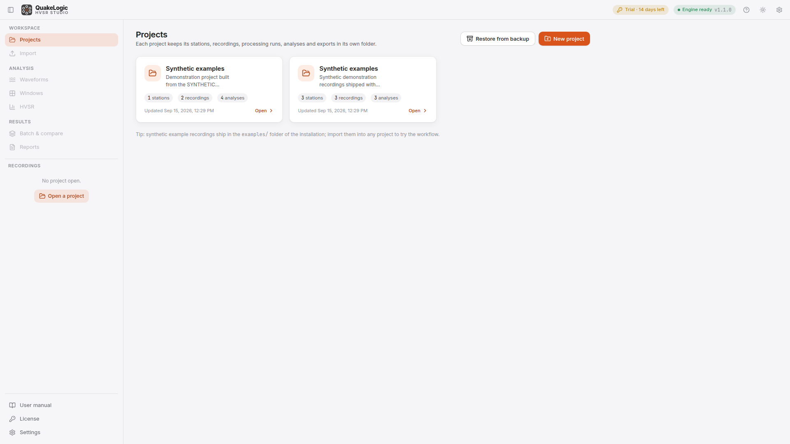</p>

### 2. Import and validation
Drop one multicolumn file, three separate component files or a multi-trace MiniSEED/SAF/GSE2/SEG-2
file onto the wizard. It previews raw lines and the parsed table, lets you correct delimiter, decimal
mark and header rows, asks you to assign **N, E and Z** explicitly, requires a sampling rate when the
file carries no timing, and validates overlap, alignment, gaps, duplicates, NaNs, clipping and
constant channels before anything is analysed.

<p align="center">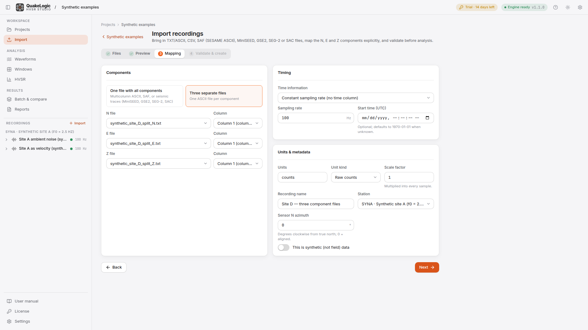</p>

### 3. Waveforms and preprocessing
Synchronized three-component plots with raw-versus-processed overlays, amplitude spectra, PSD and
spectrograms. The processing toolbox is an ordered, editable list of steps with a live preview,
filter-response plots and warnings about Nyquist limits, short records and over-processing.
"Run & save" stores a named processing run with the exact steps applied.

<p align="center">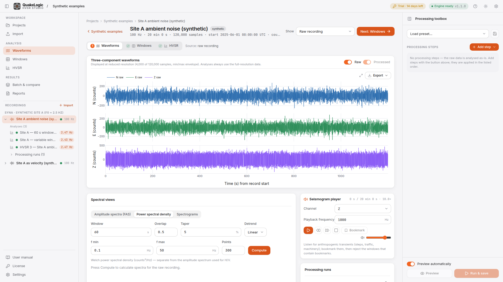</p>

### 4. Window selection
Choose fixed windows, automatic variable-length windows packed into the quiet parts of the record,
or draw your own. Transients are screened with an STA/LTA anti-trigger and amplitude levels; windows
are colour-coded by time; click any window to accept or reject it; listen to the recording with the
seismogram player and bookmark noise.

<p align="center">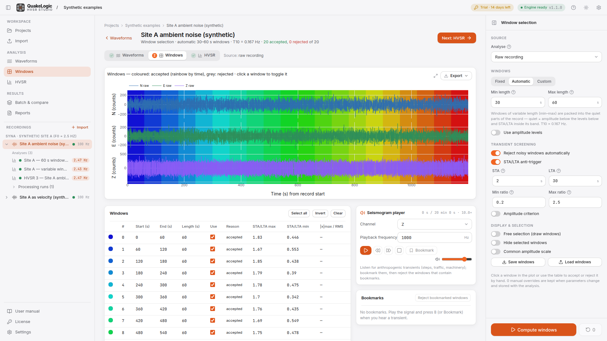</p>

### 5. HVSR analysis
The results view shows the mean curve with its dispersion band, every single-window ratio in its
window colour, candidate and selected peaks, a window table, absolute spectra in dB, the T10 limit,
and the SESAME box grid. Tabs give you H/V versus time, the azimuthal rotate map, component spectra,
the peak-frequency distribution with bootstrap interval, the window list and the detailed SESAME
table.

<p align="center">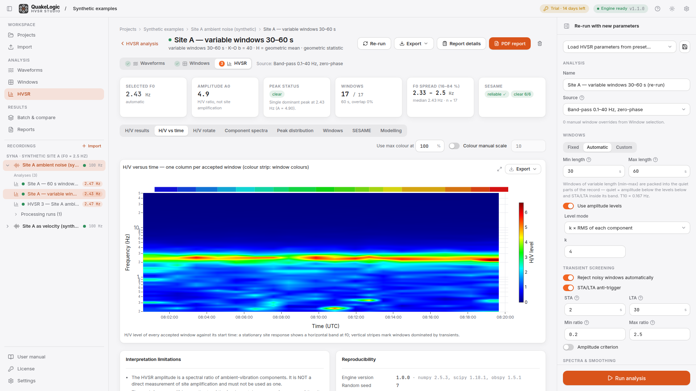</p>
<p align="center">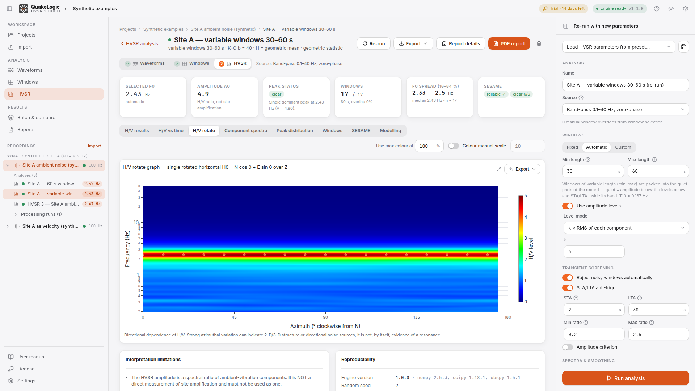</p>

### 6. Modelling
Edit a layered ground model (thickness, Vp, Vs, Poisson, density, Q), generate the synthetic H/V
curve and compare it with the measured one; Vs30, VsEq, model f0 and a misfit are computed, and the
velocity profile is drawn. Models are saved with the analysis.

<p align="center">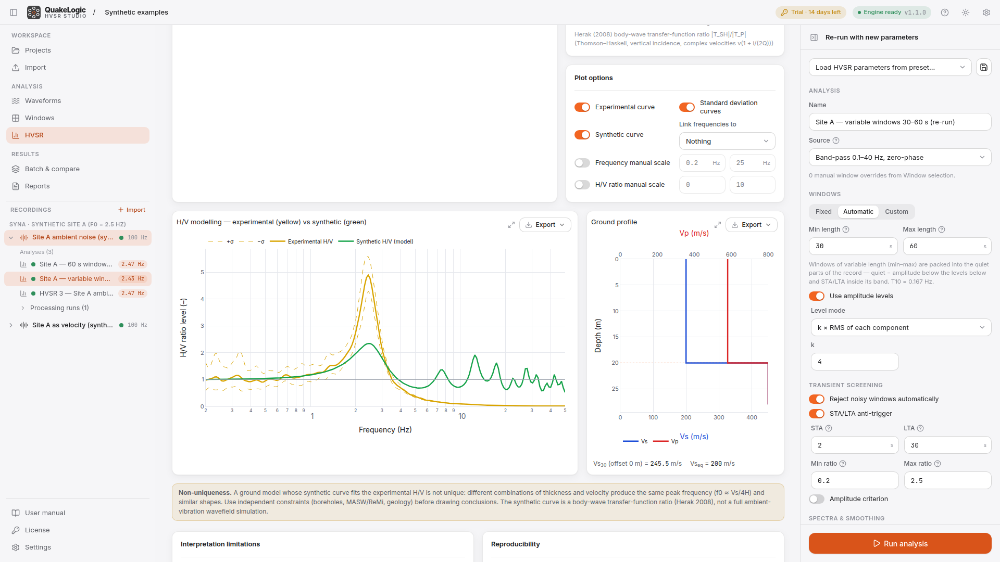</p>

### 7. Reports and exports
Fill in survey details (client, place, coordinates, weather, photos, notes) and generate the PDF
report: metadata, source files with checksums, processing settings, window statistics, figures,
peaks and variability definitions, the SESAME table, quality flags, interpretation limits, disclaimer
and copyright. Export curves and spectra as CSV, the summary as CSV/JSON, the configuration as JSON,
the mean curve as Geopsy `.hv`, and any plot as PNG, SVG or PDF.

<p align="center">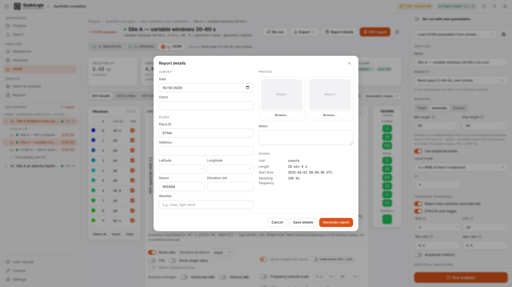</p>

### 8. Batch and comparison
Apply a saved preset to many recordings; failures are recorded and skipped. Overlay the mean curves
of any analyses, across stations or processing runs, and load external `.hv` curves for comparison.

<p align="center">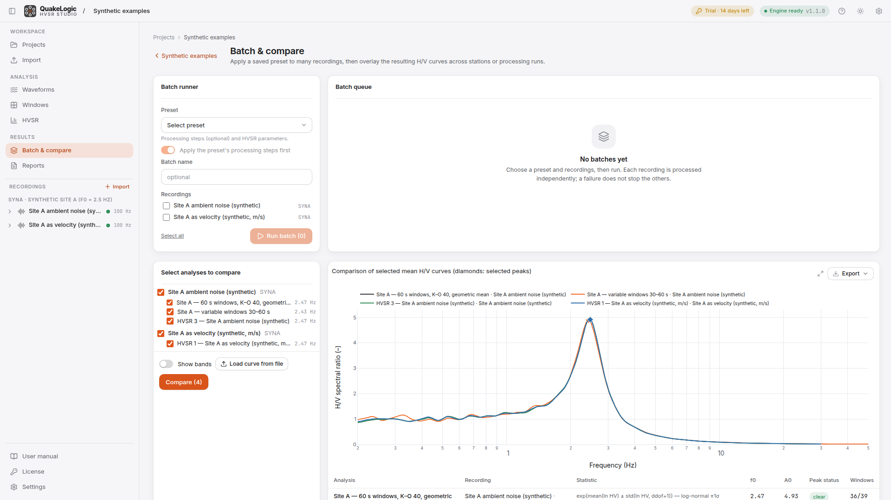</p>

## Licensing

HVSR Studio runs as a full **14-day trial** from first use on a computer. During the trial every
figure, export and report is marked **TRIAL**. Afterwards, projects can still be opened, viewed and
saved, but new calculations and exports need a licence.

A licence is a small signed `.qlicense` file issued by QuakeLogic for the **Machine ID** shown on the
**License** page. Import it there; it is verified offline and never needs a connection. Licences are
perpetual for the versions they cover and include updates released until their maintenance date.
Request one at <sales@quakelogic.net>. See the licence agreement in the in-app manual.

<p align="center">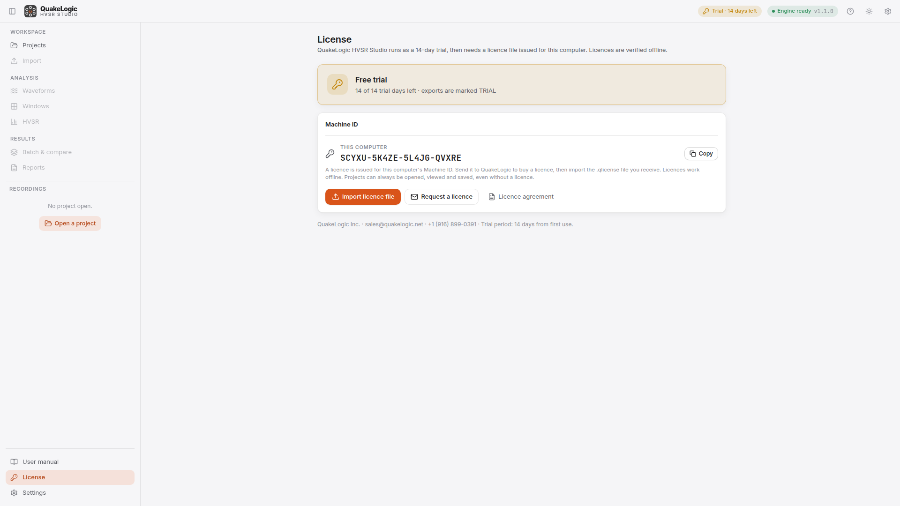</p>

## Download and install

**Windows 10/11 (64-bit)**

1. Download the installer: [QuakeLogic-HVSR-Studio-latest-setup-win-x64.exe](https://github.com/omerozgul11/quakelogic-hvsr-studio/releases/download/latest/QuakeLogic-HVSR-Studio-latest-setup-win-x64.exe)
   (rebuilt automatically from every change on `main`; numbered versions are on the
   [Releases](https://github.com/omerozgul11/quakelogic-hvsr-studio/releases) page).
2. Run it. The installer is per-user (no administrator rights), adds Start-menu and desktop icons
   and offers to start the application.
3. Click the icon: QuakeLogic HVSR Studio opens in its own window. Closing the window stops it.

The portable zip does the same without installation: unzip anywhere and double-click
`HVSR Studio.vbs`. Projects are kept in `data\` next to the program.

**macOS / Linux (from source)**

```
scripts/setup-dev.sh          # downloads a private toolchain and builds everything (internet needed once)
launcher/hvsr-studio.sh       # start (macOS: launcher/hvsr-studio.command)
```

## Supported data

| Input | Notes |
|---|---|
| TXT / CSV / DAT | any delimiter, decimal point or comma, header rows, comment lines; time column in seconds or ISO date-time, or a fixed sampling rate |
| Three separate component files | one ASCII file per component |
| MiniSEED, SAC, GSE2, SEG-2 | multi-trace files, trace picker, gaps detected |
| SESAME ASCII (`.saf`) | header-driven, three channels |
| StationXML / poles-zeros | optional instrument-response removal |
| Geopsy `.hv` | import for comparison, export of the mean curve |

## Scientific method in one paragraph

Each accepted window is linearly detrended, cosine-tapered and transformed; the Fourier amplitude
spectra of the three components are smoothed identically with the Konno–Ohmachi operator onto a
log-spaced frequency axis; the horizontals are combined (geometric mean by default, RMS or
directional available) **after** smoothing and divided by the smoothed vertical, with near-zero
vertical bins masked rather than clipped. Window curves are aggregated as the geometric (log) mean
with the log-normal ±1σ band, or as arithmetic mean ± σ, or as median with 16–84 % percentiles.
Peaks are local maxima inside the search range; window-level peak frequencies give the f0 spread,
and a seeded bootstrap over windows gives a percentile interval. The SESAME (2004) reliability and
clarity criteria are evaluated on the log-mean curve exactly as published. Full details, equations
and citations: [`docs/hvsr-algorithms.md`](docs/hvsr-algorithms.md); validation:
[`docs/validation.md`](docs/validation.md).

## Documentation

| Document | Content |
|---|---|
| [`docs/user-guide.md`](docs/user-guide.md) | installation, every screen and parameter, troubleshooting, licensing (also inside the app under *User manual*) |
| [`docs/hvsr-algorithms.md`](docs/hvsr-algorithms.md) | processing and HVSR algorithms with equations and citations |
| [`docs/validation.md`](docs/validation.md) | analytic checks and the hvsrpy cross-comparison |
| [`docs/eula.md`](docs/eula.md) | end-user licence agreement |
| [`docs/architecture.md`](docs/architecture.md) | tiers, repository layout, interface contract |
| [`docs/engine-api.md`](docs/engine-api.md), [`docs/laravel-api.md`](docs/laravel-api.md), [`docs/frontend.md`](docs/frontend.md) | per-tier references |
| [`docs/sample-report.pdf`](docs/sample-report.pdf) | example PDF report (synthetic data) |
| [`docs/marketing/`](docs/marketing/) | walkthrough video, screenshots with descriptions |
| [`packaging/README.md`](packaging/README.md) | building the Windows distribution and installer |

## Technology

Laravel 13 (PHP 8.4, SQLite) · Vue 3 + TypeScript + Tailwind CSS 4 · Plotly.js · Python 3.12 with
NumPy, SciPy, ObsPy, pandas, Matplotlib, ReportLab · FastAPI processing service · all on 127.0.0.1.
Dependencies are open source and pinned (`composer.lock`, `package-lock.json`, `engine/uv.lock`,
`engine/requirements.lock.txt`); notices in `THIRD_PARTY_NOTICES.md`.

## Development

```
source .tools/env.sh                                      # private toolchain (Linux dev host)
engine/.venv/bin/python -m pytest engine/tests            # scientific engine + service (120 tests)
php artisan test                                          # Laravel API
npx vue-tsc --noEmit && npm run build                     # frontend type-check + build
engine/.venv/bin/python engine/validation/run_validation.py
```

Every push to `main` rebuilds the Windows installer and zip on GitHub Actions and refreshes the
"latest" release; a `v*` tag publishes a numbered release.

## Support

QuakeLogic Inc. · 2008 Opportunity Dr., Suite 130, Roseville, CA 95678, USA ·
+1 (916) 899-0391 · <sales@quakelogic.net> · <https://www.quakelogic.net>

## Licence

HVSR Studio is proprietary software licensed under the [end-user licence agreement](docs/eula.md).
It includes open-source components under their own licences (`THIRD_PARTY_NOTICES.md`).
